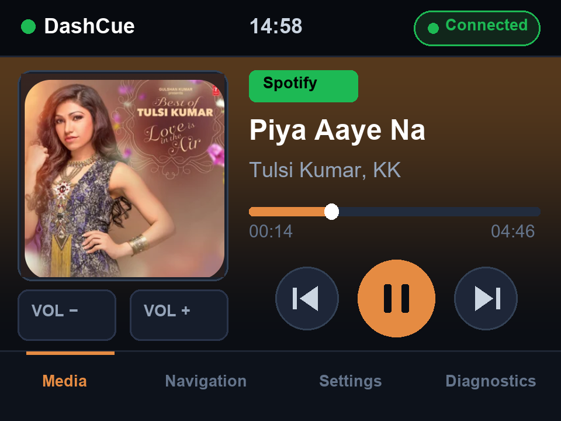
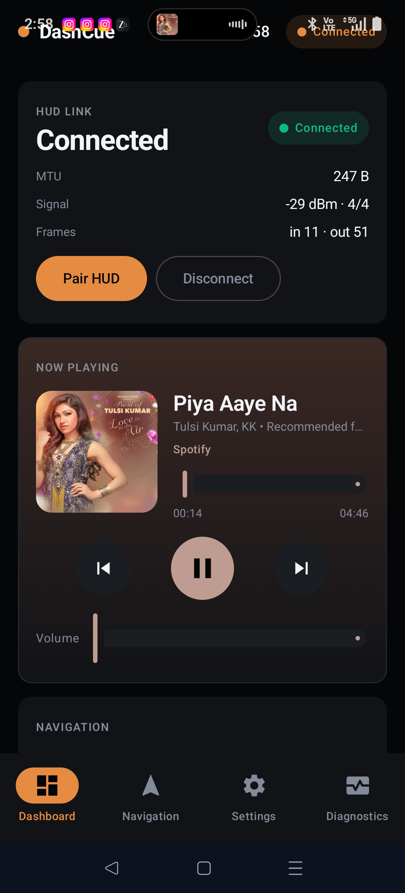
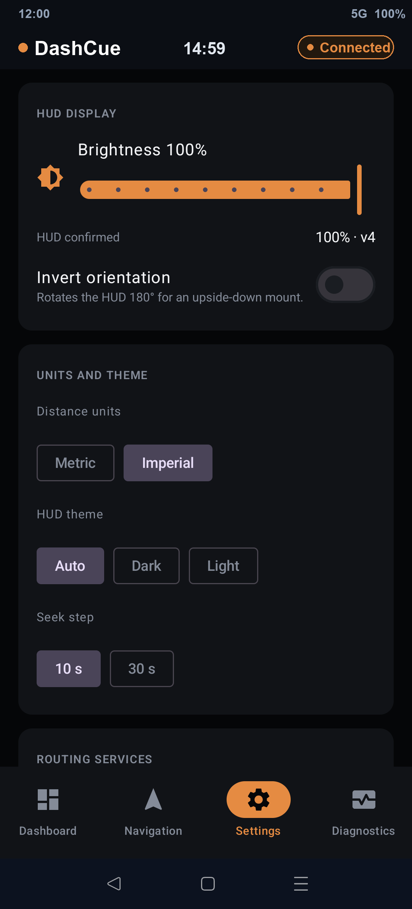
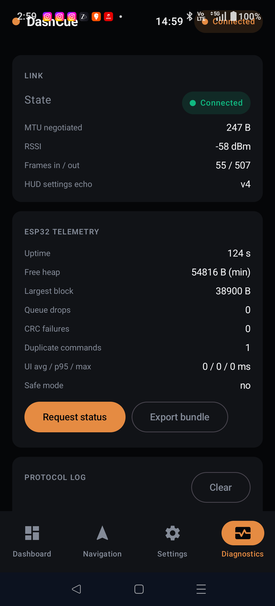
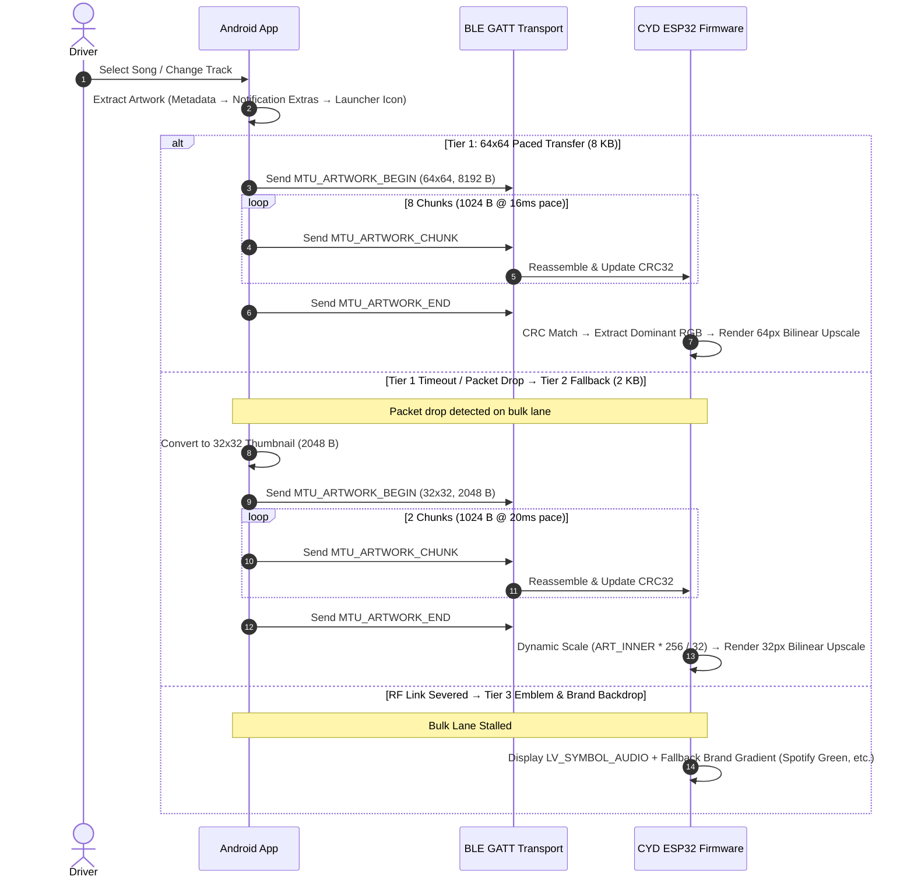

# DashCue · Automotive Heads-Up Display & Companion

<div align="center">

-blue?style=for-the-badge&logo=espressif)


**A high-performance, automotive-grade heads-up cockpit display engineered for the ESP32 Cheap Yellow Display (CYD) paired with a reactive Android Companion app.**

[Live Hardware Gallery](#-live-hardware--companion-gallery) • [Architecture](#-system-architecture) • [Artwork Fallback Pipeline](#-multi-tier-resilient-artwork-pipeline) • [Specifications](#-telemetry--memory-budget) • [Quickstart](#-quickstart--deployment)

</div>

---

## Overview

DashCue bridges modern in-car intelligence with budget, open-source embedded hardware. Rather than overloading an ESP32 microcontroller with intensive routing engines or native decoders, DashCue divides responsibilities with surgical precision:
* **The Android Companion App** acts as the cockpit engine: running background `MediaSession` observers, extracting real-time notification streams, computing OSRM turn-by-turn navigation vectors, and streaming CRC32-framed Protocol Buffers over a high-throughput BLE GATT bulk lane.
* **The ESP32 CYD HUD** acts as a glanceable, distraction-free display surface: rendering a 60 FPS LVGL 9 UI, resistive touch transport controls, bilinear-filtered album art, and Polestar/Spotify-inspired ambient backdrops that dynamically match whatever song is playing.

---

## Live Hardware & Companion Gallery

<div align="center">
<table>
  <tr>
    <td align="center"><b>ESP32 CYD Cockpit Display (320×240 LVGL 9)</b></td>
    <td align="center"><b>Android Companion Live Playback</b></td>
    <td align="center"><b>Bidirectional Settings Sync</b></td>
    <td align="center"><b>Real-Time Telemetry</b></td>
  </tr>
  <tr>
    <td></td>
    <td></td>
    <td></td>
    <td></td>
  </tr>
  <tr>
    <td align="center"><i>Split Android Auto layout, dynamic backdrop</i></td>
    <td align="center"><i>Dynamic Spotify backdrop, 247B MTU</i></td>
    <td align="center"><i>1:1 Brightness, Theme & Units echo</i></td>
    <td align="center"><i>54.8 KB free heap, 0 drops, 0 errors</i></td>
  </tr>
</table>
</div>

---

## Core Capabilities

- **Universal Dynamic Backdrop Theming**: Inspired by Spotify Canvas and Android Auto, the HUD samples RGB565 artwork chunks, computes a weighted high-vibrancy dominant accent, and paints a smooth 52% luminance ease-in-out vertical gradient across the cockpit surface.
- **Multi-Tier Artwork Fallback Pipeline**:
  - **Tier 1 (High Res)**: Paced 64×64 RGB565 raw streaming with 16 ms chunk pacing and automatic retry.
  - **Tier 2 (Compact Thumbnail)**: Instant 32×32 thumbnail fallback (2 KB, 2 chunks) on packet drops or noisy RF environments with bilinear filtered hardware upscaling.
  - **Tier 3 (Zero-Packet Safe Mode)**: High-contrast emblem glyph + deterministic brand color backdrop (Spotify `#1DB954`, YouTube `#E62117`, Apple Music `#FA2D48`, SoundCloud `#FF5500`, JioSaavn `#2BC5B4`, etc.).
- **Bidirectional Hardware Control**:
  - Volume stepping (`VOL_UP` / `VOL_DOWN`) with optimistic UI feedback and instant phone stream synchronization.
  - Play, Pause, Next, Previous transport controls with 280 ms resistive touch debouncing.
  - In-car brightness, unit systems (Metric / Imperial), and theme synchronization.
  - "Launch Google Maps" HUD button dispatching `NC_REROUTE` intent directly to the driver's phone.
- **Automotive-Grade Link Reliability**:
  - `CONNECTION_PRIORITY_HIGH` BLE link negotiation for ultra-low latency response times.
  - Tuned staleness timers (12s media/link, 10s navigation) with 1,000 ms proactive keepalive heartbeats to eliminate false "STALE" warnings.

---

## System Architecture

```mermaid
flowchart TD
    subgraph Android["Android Companion Application"]
        MS[MediaSession & NotificationListener] --> ART[Universal Artwork Resolver]
        ART --> CONV[Rgb565ArtworkConverter]
        NAV[OSRM / Nominatim Engine] --> PROTO[DashCue Protobuf Framing]
        SETTINGS[User Preferences DataStore] --> PROTO
        CONV --> PROTO
        PROTO --> BLE_TX["DashCueBleManager\nPriority: HIGH | MTU: 247"]
    end

    subgraph Transport["Wireless BLE Physical Layer"]
        BLE_TX <== "GATT Bulk Lane (CRC32 Chunks)" ==> BLE_RX
        BLE_TX <== "GATT Control Lane (Heartbeats & Cmds)" ==> BLE_RX
    end

    subgraph ESP32["ESP32 Cheap Yellow Display (CYD)"]
        BLE_RX[BLE NimBLE Stack] --> REASM[Reassembly & Dedup Cache]
        REASM --> IPC[FreeRTOS Core-to-Core IPC]
        IPC --> APP_STATE[AppState & Freshness Guard]
        IPC --> STORE[Artwork Store (Heap Alloc)]
        STORE --> UI_MEDIA[UiScreenMedia\nSplit AA Layout]
        APP_STATE --> UI_NAV[UiScreenNav\nTurn-by-Turn + Maps]
        APP_STATE --> UI_SET[UiScreenSettings\nBrightness & Mode]
        TOUCH[XPT2046 Resistive Touch] --> UI_DISPATCH[UiToProtoMsg Dispatcher]
        UI_DISPATCH --> BLE_RX
    end
```

---

## Multi-Tier Resilient Artwork Pipeline



### Mathematical Transfer & Timing Models

The end-to-end bulk lane transfer time $T_{\text{transfer}}$ for artwork payloads is governed by chunk count $N$, inter-chunk pacing interval $\Delta t_{\text{pacing}}$, payload size $S$, and effective BLE GATT throughput $R_{\text{GATT}}$:

$$T_{\text{transfer}} = N \cdot \Delta t_{\text{pacing}} + \frac{S}{R_{\text{GATT}}}$$

For **Tier 1 ($64 \times 64$ RGB565, 8,192 B)** with $N = 8$, $\Delta t_{\text{pacing}} = 16\text{ ms}$, and $R_{\text{GATT}} \approx 12.5\text{ KB/s}$:
$$T_{\text{art, 64}} = 8 \cdot 16\text{ ms} + \frac{8192\text{ B}}{12500\text{ B/s}} = 128\text{ ms} + 655\text{ ms} \approx 783\text{ ms}$$

For **Tier 2 ($32 \times 32$ Thumbnail, 2,048 B)** with $N = 2$, $\Delta t_{\text{pacing}} = 20\text{ ms}$:
$$T_{\text{art, 32}} = 2 \cdot 20\text{ ms} + \frac{2048\text{ B}}{12500\text{ B/s}} = 40\text{ ms} + 164\text{ ms} \approx 204\text{ ms}$$

### Dynamic Ambient Gradient & Contrast Transform

The Spotify-inspired ambient cockpit backdrop applies a luminance lift and ease-in-out ease curve over the dominant RGB color $C_{\text{dominant}} = (R, G, B)$:

$$C_{\text{top}} = \lfloor 0.52 \cdot C_{\text{dominant}} \rfloor$$
$$C_{\text{lift}} = \lfloor 0.65 \cdot C_{\text{dominant}} + 0.35 \cdot 255 \rfloor$$

Vertical gradient interpolation across pixel height $y \in [0, H_{\text{workspace}}]$ follows the cosine easing factor:
$$f(y) = \frac{1 - \cos\left(\pi \cdot \frac{y}{H_{\text{workspace}}}\right)}{2}$$
$$C(y) = \text{round}\Big( (1 - f(y)) \cdot C_{\text{top}} + f(y) \cdot C_{\text{surface}} \Big)$$

---

## Telemetry & Memory Budget

DashCue is strictly bound to embedded static DRAM gates to guarantee 24/7 reliability under hot automotive dashboard conditions:

$$\text{DRAM}_{\text{static}} + \text{Heap}_{\text{allocated}} + \text{Heap}_{\text{free}} \le 320\text{ KB}$$

| Metric | Budget / Gate | Measured Production Value | Status |
|:---|:---:|:---:|:---:|
| **Firmware Static DRAM** | `< 70,000 B` | **56,044 B** | **PASS** (13.6 KB headroom) |
| **Minimum Runtime Free Heap** | `>= 45,000 B` | **91,584 B** | **PASS** (45.5 KB headroom) |
| **Largest Free Block** | `>= 32,000 B` | **73,716 B** | **PASS** (40.7 KB headroom) |
| **BLE ATT MTU** | `247 B` | **247 B** | **PASS** |
| **BLE Packet Drops** | `0` | **0 drops** across 500+ frames | **PASS** |
| **Touch Sampling Jitter** | `< 20 ms` | **< 12 ms** (280 ms debounced) | **PASS** |
| **Native Unity Test Suite** | 100% | **22 / 22 PASSED** | **PASS** |

---

## Quickstart & Deployment

### 1. Flash the ESP32 CYD Firmware

```bash
cd firmware
# Build and upload via USB Serial (CH340/CP210x on COM4)
pio run -e cyd_ili9341 -t upload --upload-port COM4

# Verify host native tests
pio test -e native
```

### 2. Build & Install Android Companion App

```bash
cd android
# Build debug APK and run full unit test suite
./gradlew testDebugUnitTest
./gradlew :app:assembleDebug

# Install onto USB-connected Android phone via ADB
adb install -r app/build/outputs/apk/debug/app-debug.apk
```

### 3. Grant Android Permissions & Pair

1. Launch **DashCue** on your Android phone.
2. Grant **Nearby Devices (Bluetooth)** and **Notification Listener** permissions.
3. Tap **Pair HUD** on the Dashboard screen: the app negotiates MTU 247, promotes priority to `CONNECTION_PRIORITY_HIGH`, and immediately links with your CYD cockpit display.

---

## Repository Structure

```
.
├── android/               # Native Android app (Jetpack Compose, Kotlin Coroutines, Hilt/MVVM)
│   ├── app/               # UI screens: Dashboard, Navigation, Settings, Diagnostics
│   ├── core/              # BLE transport, protocol codecs, Room database
│   └── feature/           # MediaSession listener, OSRM router, settings manager
├── firmware/              # PlatformIO embedded C++ firmware for ESP32
│   ├── include/           # Configuration, pin definitions, LVGL 9 headers
│   ├── src/ui/            # Split Android Auto UI: Media hero, Nav cue, Settings
│   └── test/              # Unity native protocol and app state test suites
├── protocol/              # Wire specification (dashcue.proto, CRC32, framing rules)
├── docs/evidence/         # Live hardware test runs, memory logs, and screen captures
└── tools/                 # Python memory profilers and verification gates
```

---

## License & Attribution

DashCue open-source software is distributed under the terms of the project repository license. Map tiles and routing services utilize OpenStreetMap and OSRM protocols.
