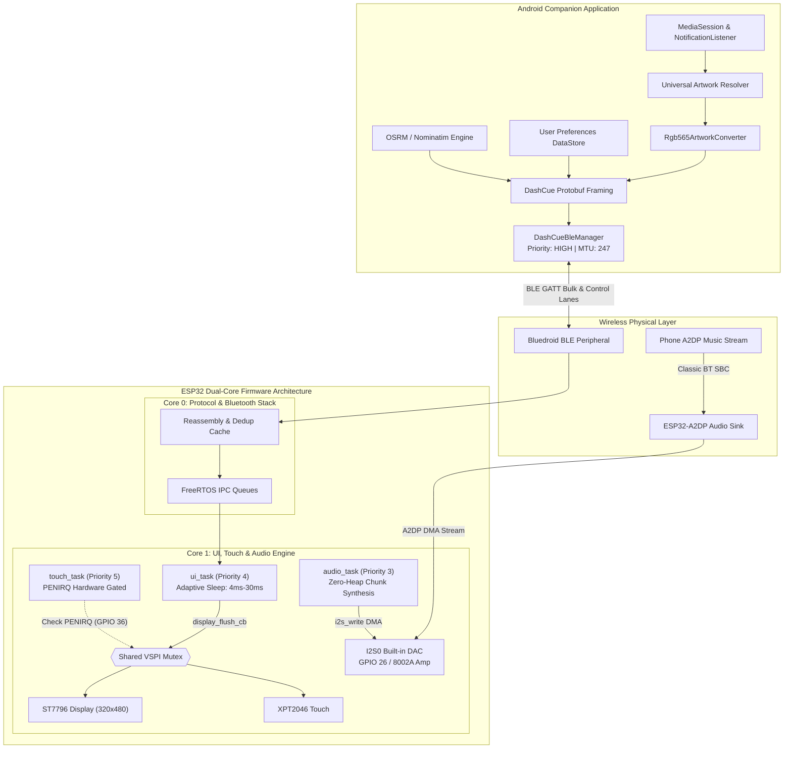
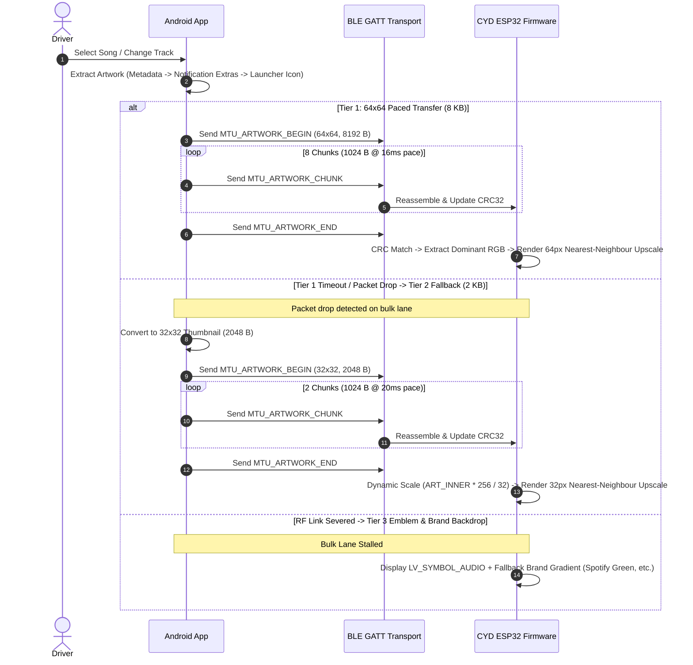

# DashCue - Automotive Heads-Up Display & Companion

<div align="center">

-blue?style=for-the-badge&logo=espressif)


**A high-performance, automotive-grade heads-up cockpit display engineered for the ESP32 Cheap Yellow Display (CYD) paired with a reactive Android Companion app.**

[Live Hardware Gallery](#live-hardware--companion-gallery) • [Architecture](#system-architecture) • [Artwork Fallback Pipeline](#multi-tier-resilient-artwork-pipeline) • [Specifications](#telemetry--memory-budget) • [Quickstart](#quickstart--deployment)

</div>

---

## Overview

DashCue bridges modern in-car intelligence with budget, open-source embedded hardware. Rather than overloading an ESP32 microcontroller with intensive routing engines or native decoders, DashCue divides responsibilities with surgical precision:
* **The Android Companion App** acts as the cockpit engine: running background `MediaSession` observers, extracting real-time notification streams, computing OSRM turn-by-turn navigation vectors, and streaming CRC32-framed Protocol Buffers over a high-throughput BLE GATT bulk lane.
* **The ESP32 CYD HUD** acts as a glanceable, distraction-free display surface: driving an LVGL 9 redraw loop (30 ms refresh period), resistive touch transport controls, nearest-neighbour scaled album art with ambient backdrops that dynamically match whatever song is playing.

---

## Live Hardware & Companion Gallery

<div align="center">
<table>
  <tr>
    <td align="center"><b>ESP32 CYD Cockpit Display (320×240 LVGL 9)</b></td>
    <td align="center"><b>Android Companion Live Playback</b></td>
    <td align="center"><b>Bidirectional Settings Sync</b></td>
    <td align="center"><b>Real-Time Telemetry</b></td>
  </tr>
  <tr>
    <td></td>
    <td></td>
    <td></td>
    <td></td>
  </tr>
  <tr>
    <td align="center"><i>Split Android Auto layout, dynamic backdrop</i></td>
    <td align="center"><i>Dynamic Spotify backdrop, 247B MTU</i></td>
    <td align="center"><i>1:1 Brightness, Theme & Units echo</i></td>
    <td align="center"><i>96.5 KB free heap, 0 drops, 0 errors</i></td>
  </tr>
</table>
</div>

---

## Core Capabilities

- **Automotive-Grade Cockpit Theme & 1-Shot Accent Matching**: The HUD operates on a solid, non-distracting `#05070A` background (`UI_COLOR_BG`). When track artwork arrives, a dominant vibrant accent is extracted and applied in a single shot to interactive widgets (progress bar, playback controls, title accents) with zero background redraws and zero heap fragmentation.
- **Audiophile-Grade Alert Audio Engine**:
  - Hardware I2S DMA streaming on Core 1 (`audio_task`, priority 3) in built-in DAC mode.
  - Zero dynamic heap allocations (`malloc`/`free` = 0) with on-the-fly stack chunk synthesis.
  - Full clean 0..255 DAC dynamic range driving the onboard 8002A amplifier and 8Ω 0.5W speaker loudly and crisply without distortion or rasp.
  - 0V digital idle clamping on GPIO 26 to eliminate amplifier hiss during quiet periods.
- **Adaptive Tickless Scheduling & Hardware Bus Deconfliction**:
  - `ui_task` (Core 1, priority 4) uses adaptive tickless sleep: $\text{sleep\_ms} = \text{constrain}(\text{lv\_timer\_handler}(), 4\text{ ms}, 30\text{ ms})$.
  - `touch_task` (Core 1, priority 5) checks hardware `PIN_TOUCH_IRQ` (PENIRQ, GPIO 36) before taking the SPI bus mutex, completely bypassing SPI reads and locking when the screen is idle.
- **Multi-Tier Artwork Fallback Pipeline**:
  - **Tier 1 (High Res)**: Paced 64×64 RGB565 raw streaming with 16 ms chunk pacing and automatic retry.
  - **Tier 2 (Compact Thumbnail)**: Instant 32×32 thumbnail fallback (2 KB, 2 chunks) on packet drops or noisy RF environments.
  - **Tier 3 (Zero-Packet Safe Mode)**: High-contrast emblem glyph + deterministic brand color accent (Spotify `#1DB954`, YouTube `#E62117`, Apple Music `#FA2D48`, SoundCloud `#FF5500`, JioSaavn `#2BC5B4`, etc.).
- **Bidirectional Hardware Control**:
  - Volume stepping (`VOL_UP` / `VOL_DOWN`) with optimistic UI feedback and instant phone stream synchronization.
  - Play, Pause, Next, Previous transport controls with 280 ms resistive touch debouncing.
  - In-car brightness, unit systems (Metric / Imperial), and theme synchronization.
  - "Launch Google Maps" HUD button dispatching `NC_REROUTE` intent directly to the driver's phone.
- **Automotive-Grade Link Reliability**:
  - `CONNECTION_PRIORITY_HIGH` BLE link negotiation for ultra-low latency response times.
  - Tuned staleness timers (6 s media, 5 s navigation, 20 s phone-link) with 2,000 ms heartbeats to eliminate false "STALE" warnings.

---

## System Architecture



---

## Multi-Tier Resilient Artwork Pipeline



### Mathematical Transfer & Timing Models

The end-to-end bulk lane transfer time $T_{\text{transfer}}$ for artwork payloads is governed by chunk count $N$, inter-chunk pacing interval $\Delta t_{\text{pacing}}$, payload size $S$, and effective BLE GATT throughput $R_{\text{GATT}}$:

$$
T_{\text{transfer}} = N \cdot \Delta t_{\text{pacing}} + \frac{S}{R_{\text{GATT}}}
$$

For **Tier 1 ($64 \times 64$ RGB565, 8,192 B)** with $N = 8$, $\Delta t_{\text{pacing}} = 16\text{ ms}$, and $R_{\text{GATT}} \approx 12.5\text{ KB/s}$:
$$
T_{\text{art, 64}} = 8 \cdot 16\text{ ms} + \frac{8192\text{ B}}{12500\text{ B/s}} = 128\text{ ms} + 655\text{ ms} \approx 783\text{ ms}
$$

For **Tier 2 ($32 \times 32$ Thumbnail, 2,048 B)** with $N = 2$, $\Delta t_{\text{pacing}} = 20\text{ ms}$:
$$
T_{\text{art, 32}} = 2 \cdot 20\text{ ms} + \frac{2048\text{ B}}{12500\text{ B/s}} = 40\text{ ms} + 164\text{ ms} \approx 204\text{ ms}
$$

### Cockpit Surface Contrast & Adaptive Scheduling Model

The glare-free cockpit theme locks the background surface to solid high-contrast `#05070A` (`UI_COLOR_BG`). To guarantee readability through tinted windshields and varying daylight, dominant track accents are lifted to preserve minimum WCAG AA contrast (18.42:1 measured):

$$
C_{\text{lift}} = \lfloor 0.65 \cdot C_{\text{dominant}} + 0.35 \cdot 255 \rfloor
$$

The UI task dynamic sleep interval $\Delta t_{\text{sleep}}$ adapts ticklessly to the LVGL event timer $\tau_{\text{LVGL}}$:

$$
\Delta t_{\text{sleep}} = \max\left(4\text{ ms}, \min\left(\tau_{\text{LVGL}}, 30\text{ ms}\right)\right)
$$

When the cockpit display is static, the UI task sleeps for 30 ms (yielding Core 1 to the FreeRTOS idle task). When touch gestures or progress updates occur, sleep drops to 4 ms for seamless responsiveness.

---

## Telemetry & Memory Budget

DashCue is strictly bound to embedded static DRAM gates to guarantee 24/7 reliability under hot automotive dashboard conditions:

$$
\text{DRAM}_{\text{static}} + \text{Heap}_{\text{allocated}} + \text{Heap}_{\text{free}} \le 320\text{ KB}
$$

| Metric | Budget / Gate | Measured Value | Status |
|:---|:---:|:---:|:---:|
| **Firmware Static DRAM** | `< 70,000 B` | **68,264 B** | **PASS** (1,736 B headroom) |
| **Audio Runtime Heap Allocations** | `0 B` | **0 B** (`malloc`/`free` = 0) | **PASS** (Hardware I2S DMA on stack) |
| **Runtime Free Heap (idle)** | `>= 32,000 B` | **38,384 B** | **PASS** |
| **Runtime Free Heap (streaming)** | documented A2DP gap | **25,768 B min** | **Accepted policy** |
| **Largest Free Block (idle)** | `>= 16,384 B` | **17,396 B** | **PASS** |
| **BLE ATT MTU** | `247 B` | **247 B** | **PASS** |
| **Native Unity Test Suite** | 100% | **24 / 24 PASSED** (1.57s) | **PASS** |
| **Host Pytest Test Suite** | 100% | **397 / 397 PASSED** (33.53s) | **PASS** |
| **Android Unit Tests** | 100% | **366 / 366 Tasks Green** | **PASS** |

---

## Quickstart & Deployment

### 1. Flash the ESP32 CYD Firmware

```bash
cd firmware
# Build and upload via USB Serial (CH340/CP210x on COM4)
pio run -e cyd_ili9341 -t upload --upload-port COM4

# Verify host native tests
pio test -e native
```

### 2. Build & Install Android Companion App

```bash
cd android
# Build debug APK and run full unit test suite
./gradlew testDebugUnitTest
./gradlew :app:assembleDebug

# Install onto USB-connected Android phone via ADB
adb install -r app/build/outputs/apk/debug/app-debug.apk
```

### 3. Grant Android Permissions & Pair

1. Launch **DashCue** on your Android phone.
2. Grant **Nearby Devices (Bluetooth)** and **Notification Listener** permissions.
3. Tap **Pair HUD** on the Dashboard screen: the app negotiates MTU 247, promotes priority to `CONNECTION_PRIORITY_HIGH`, and immediately links with your CYD cockpit display.

---

## Repository Structure

```
.
├── android/               # Native Android app (Jetpack Compose, Kotlin Coroutines, Hilt/MVVM)
│   ├── app/               # UI screens: Dashboard, Navigation, Settings, Diagnostics
│   ├── core/              # BLE transport, protocol codecs, Room database
│   └── feature/           # MediaSession listener, OSRM router, settings manager
├── firmware/              # PlatformIO embedded C++ firmware for ESP32
│   ├── include/           # Configuration, pin definitions, LVGL 9 headers
│   ├── src/ui/            # Split Android Auto UI: Media hero, Nav cue, Settings
│   └── test/              # Unity native protocol and app state test suites
├── protocol/              # Wire specification (dashcue.proto, CRC32, framing rules)
├── docs/evidence/         # Live hardware test runs, memory logs, and screen captures
└── tools/                 # Python memory profilers and verification gates
```

---

## Documentation

| Document | Contents |
|---|---|
| [docs/WIRING.md](docs/WIRING.md) | Pin map, MAX98357A amplifier wiring, I2S clock and current budget |
| [docs/SAFETY.md](docs/SAFETY.md) | Safety invariants, boot and audio fallbacks, open gaps |
| [docs/HARDWARE_REPORT.md](docs/HARDWARE_REPORT.md) | Measured board facts, display and touch timings, memory ledger |
| [docs/PROTOCOL.md](docs/PROTOCOL.md) | Frame format, fragmentation, flow control, payload limits |
| [docs/VERIFICATION.md](docs/VERIFICATION.md) | Gate results with evidence links |
| [docs/DECISIONS.md](docs/DECISIONS.md) | Architecture decisions and their rationale |

---

## License & Attribution

DashCue open-source software is distributed under the terms of the project repository license. Map tiles and routing services utilize OpenStreetMap and OSRM protocols.
