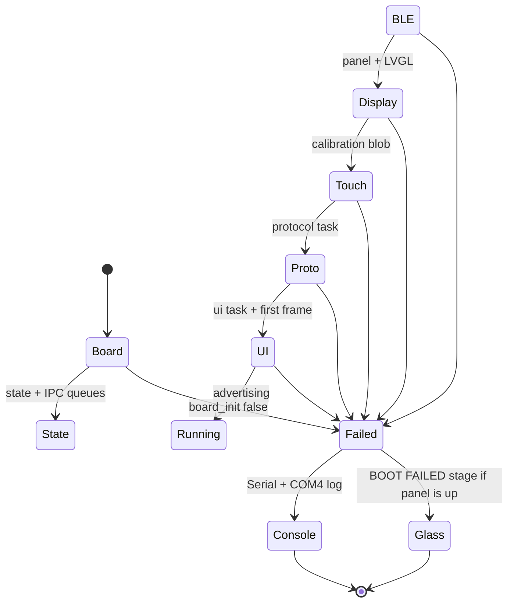
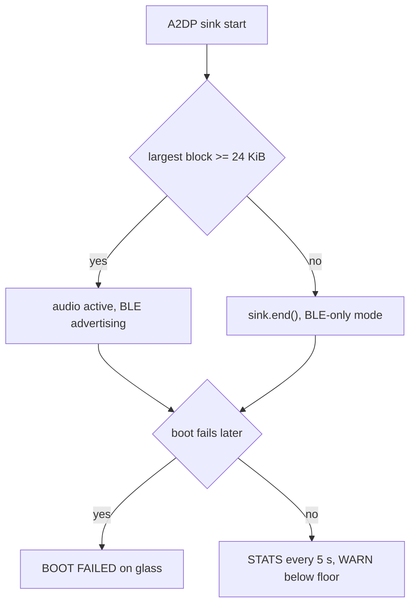

# Safety and fallbacks

This file lists the conditions the firmware must never violate, and what happens
when it cannot meet them. Each entry states the mechanism, where it lives, and how
it is verified. Anything not verified is marked as such.

## 1. Invariants

| ID | Invariant | Bound | Where |
|---|---|---|---|
| INV-1 | Largest free block stays above the audio floor | $H_{\text{largest}} \ge 24\ \text{KiB}$ when audio is enabled | `DASHCUE_HEAP_FLOOR_BYTES`, boot guard in `main.cpp` |
| INV-2 | Steady state heap above the operating floor | $H_{\text{free}} \ge 40\ \text{KiB}$ | `STATS` prints `WARN heap_floor` below it |
| INV-3 | Boot to usable UI | $t_{\text{boot}} \le 3000\ \text{ms}$ | `BOOT boot_to_ui_ms` line |
| INV-4 | No frame over the hard limit | $\max(t_{\text{frame}}) \le 100\ \text{ms}$ in steady state | `frame_max_ms` in `STATS` |
| INV-5 | Payload never exceeds the advertised cap | $L \le 2048\ \text{B}$ | `DASHCUE_MAX_PAYLOAD_SIZE`, advertised in `HELLO_ACK` |
| INV-6 | Touch never maps through an unvalidated fit | residual mean $\le 6\ \text{px}$, max $\le 12\ \text{px}$ | `touch_calibration_solve`, blob in NVS |
| INV-7 | A crash leaves evidence | coredump partition present | `partitions.csv`, 64 KiB at `0x3F0000` |

The audio margin is treated as a ratio rather than a raw byte count, because the
same figure has to mean something whether the sink holds 20 KB or 60 KB:

$$
M = \frac{H_{\text{largest}} - H_{\text{floor}}}{H_{\text{floor}}}
$$

With the measured A2DP build, $H_{\text{largest}} = 32756\ \text{B}$ against
$H_{\text{floor}} = 24576\ \text{B}$, giving $M = 0.33$. Anything below $M = 0$ is
the condition that stops the sink.

INV-4 is currently violated at boot: the first full paint measures about 313 ms for
one frame, against a 100 ms limit. The limit is written for steady state, but the
metric does not distinguish the two, so the `STATS` line reports the violation
honestly rather than hiding it. Steady state after boot reports 0 ms because an
idle screen flushes nothing.

## 2. Boot failure path

Before 2026-10-20 a failed boot printed to COM4 and returned, leaving a black
panel. That is indistinguishable from a dead board when the unit is on a desk
without a serial adapter. `fail_boot()` now calls `display_hal_show_boot_error()`
when the panel has initialised, which paints the failing stage with raw TFT_eSPI,
bypassing LVGL because the UI task may not exist at that point.

If the display itself fails, only the serial log remains. That limitation is
recorded, not worked around: the panel is the only output device on the board.

## 3. Audio fallbacks

Audio is optional by construction. The HUD is a display and controller first.

Implemented in `main.cpp` under `DASHCUE_ENABLE_A2DP`: after `sink.start()` the
guard reads `heap_caps_get_largest_free_block` and calls `sink.end()` when the
result is under the floor, so a failed audio allocation degrades to the product
that already works instead of crashing later inside the audio path.

## 4. Touch and calibration

The five point fit is rejected unless its residual mean and maximum fall inside the
bounds above. Three defence layers exist for a bad panel:

1. Samples are the median of a 64 entry buffer after a 3 read settle window, so a
   single noisy press cannot move a calibration point.
2. A failed fit parks on "Tap the panel to try again" instead of restarting the
   wizard, which previously made a failure look like an infinite loop.
3. Out of range raw values and `z >= 4090` are treated as no touch, because a
   floating bus returns saturated values that pass a naive pressure test.

## 5. Protocol safety

| Attack or fault | Response |
|---|---|
| Frame shorter than 20 bytes | rejected with `EC_DECODE` |
| Declared length over the cap | rejected before reading the payload |
| CRC mismatch | rejected with `EC_CRC` |
| Duplicate command id | replay from the dedupe cache, no re-execution |
| Fragment burst over the buffer | rejected at `DASHCUE_MAX_FRAME_SIZE` |
| Peer advertises a larger cap | local cap wins, phone clamps its send size |

The cap is 2048 bytes as of 2026-10-20 and is advertised in `HELLO_ACK.max_msg_size`.
The phone derives its transport limit from `min(ack.maxMsgSize, its own max)`, so
the contract is negotiated rather than assumed.

## 6. Still missing

Listed so nobody reads the table above as complete.

1. **Task watchdog.** `ui_task`, `proto_task` and `touch_task` are not registered
   with the ESP task watchdog. A hung task today keeps the last frame on screen and
   stops updating, with no reset.
2. **Brownout recovery.** The ESP32 brownout detector resets the chip, and the
   reset reason is recorded, but nothing surfaces "last reset was a brownout" to
   the user. With an amplifier on the 5 V rail this becomes a likely field failure.
3. **Coredump readback.** The partition now exists and boot no longer reports it
   missing, but no tool reads a dump back over serial. `esptool.py` can do it;
   the procedure is not documented here yet.
4. **Stack overflow detection.** High water marks are printed every 30 s, but
   `configCHECK_FOR_STACK_OVERFLOW` is a core build setting and is not enabled in
   this precompiled Arduino core.
5. **Watchdog on BLE stack.** A Bluedroid assert halts the board; nothing recovers.

## 7. Verification status

| Item | Status | Evidence |
|---|---|---|
| Boot failure screen | implemented, not triggered | code path in `fail_boot`, no forced failure run |
| Coredump partition | verified | boot log has zero `core_dump` errors, `docs/evidence/20261020/safety/` |
| Heap floor warning | implemented, not triggered | largest block 73,716 B is above 40,960 B |
| Audio headroom fallback | implemented, not triggered | probe measured 32,756 B against a 24,576 B floor |
| Payload cap | verified | 22/22 native tests, fixtures and spec updated |
| Calibration bounds | verified on device | `Mean err=4.38 px, Max err=4.86 px` |
