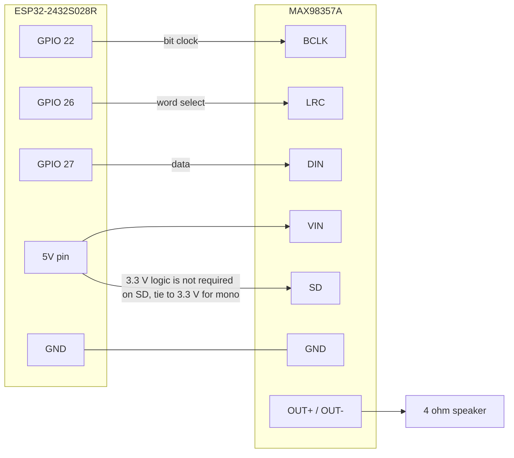

# Wiring and pinout

Measured board: ESP32-2432S028R ("Cheap Yellow Display"), ESP32 rev 3, 4 MB flash,
no PSRAM. Every pin below comes from `firmware/include/dashcue_config.h`, which
records the values the M1 hardware probe measured on this unit.

## 1. Pin map in use

| Function | Signal | GPIO | Direction | Notes |
|---|---|---|---|---|
| Display | MISO | 12 | in | panel never read back; RDDID returns 0x0000 |
| Display | MOSI | 13 | out | 40 MHz SPI |
| Display | SCLK | 14 | out | 40 MHz SPI |
| Display | CS | 15 | out | |
| Display | DC | 2 | out | |
| Display | RST | -1 | - | tied to the EN net, no GPIO |
| Display | BL | 21 | out | LEDC PWM, 5 kHz, active HIGH |
| Touch | SCLK | 25 | out | separate bus, 2.5 MHz |
| Touch | MOSI | 32 | out | |
| Touch | MISO | 39 | in | input only pin |
| Touch | CS | 33 | out | no IRQ line, polled at 100 Hz |
| Status LED | R | 4 | out | |
| Status LED | G | 16 | out | |
| Status LED | B | 17 | out | |
| Ambient light | LDR | 34 | in | ADC1, input only |
| Audio | BCLK | 22 | out | I2S bit clock |
| Audio | LRC | 26 | out | I2S word select |
| Audio | DIN | 27 | out | I2S data to the amplifier |

GPIO 22, 26, 27 are free on this board. GPIO 26 was reserved as `PIN_SPEAKER` in
an earlier revision and is now the I2S word-select line; nothing else claims it.

Do not use GPIO 6 to 11 (flash), 34 to 39 as outputs (input only), or 0, 2, 12, 15
as strapping pins at boot beyond what the display already drives.

## 2. MAX98357A amplifier

The MAX98357A is a class D I2S amplifier with an integrated DAC. It needs no
configuration bus: the I2S stream is the only control surface.

| Amplifier pin | Connect to | Reason |
|---|---|---|
| VIN | 5 V rail (CYD 5 V pin, USB source) | 3 W into 4 ohm needs headroom; at 3.3 V output is roughly 1 W |
| GND | Common ground, star point at the CYD GND pin | keeps I2S return currents out of the analog side |
| BCLK | GPIO 22 | I2S bit clock |
| LRC | GPIO 26 | I2S word select |
| DIN | GPIO 27 | I2S data |
| SD | 3.3 V for mono (L+R)/2; 100 kOhm to 3.3 V for left only; 200 kOhm for right only; GND for shutdown | channel and shutdown select |
| GAIN | leave open for 9 dB, or resistor to VIN/GND per datasheet | 3, 6, 9, 12, 15 dB steps |
| OUT+ / OUT- | speaker, 4 or 8 ohm | do not connect either side to ground |

### 2.1 Clock arithmetic

I2S in Philips format with 16-bit samples and two channels uses 32 bit clocks per
frame:

$$
f_{BCLK} = 2 \cdot 16 \cdot f_s = 32 f_s
$$

At 44.1 kHz this is:

$$
f_{BCLK} = 32 \cdot 44100 = 1.4112\ \text{MHz}
$$

The ESP32 I2S peripheral derives this from APLL or PLL_D2, so the HDMI-style
fractional divider is not required. At 48 kHz the same formula gives 1.536 MHz.

### 2.2 Supply and current

Class D output power into a load $R_L$ at supply $V_{DD}$ is bounded by:

$$
P_{out} \le \frac{V_{DD}^2}{2 R_L}
$$

For $V_{DD} = 5\ \text{V}$ and $R_L = 4\ \Omega$ the bound is 3.1 W, which matches
the datasheet figure. Peak current at that point is:

$$
I_{peak} = \sqrt{\frac{P}{R_L}} = \sqrt{\frac{3}{4}} \approx 0.87\ \text{A}
$$

That current does not come from the ESP32 regulator. Feed VIN from the 5 V input
rail, add a 470 uF bulk capacitor near the amplifier, and keep the speaker return
separate from the I2S ground until the star point. A weak USB port shows up as
brownout resets during loud passages, which the ESP32 brownout detector reports as
reset reason 9.

### 2.3 What is not wired yet

The firmware audio path is a measurement build (`env:probe_a2dp`). It starts the
A2DP sink but leaves I2S at library defaults; the pin map above is implemented only
when the sink is promoted to a product environment. Until then, sound is not
verified and this document is a wiring plan, not a proven configuration.

## 3. Power budget

| Load | Typical | Peak | Source |
|---|---|---|---|
| ESP32 + display backlight | 180 mA | 260 mA | measured board current at full backlight |
| MAX98357A, quiet | 6 mA | 6 mA | datasheet quiescent |
| MAX98357A, music | 150 mA | 870 mA | section 2.2 at 5 V into 4 ohm |
| Total | 340 mA | 1.14 A | |

Use a 5 V 1.5 A source. The CYD's onboard regulator is rated for the board only;
the amplifier must not be powered through it.

## 4. Bring-up order

1. Power the board alone, confirm `BOOT boot_to_ui_ms` under 3000 ms on COM4.
2. Wire BCLK, LRC, DIN, and GND only. Leave VIN disconnected.
3. Confirm boot is unchanged with the amplifier unpowered.
4. Connect VIN and GND, confirm no brownout in the boot log.
5. Play a test tone and confirm the HUD keeps advertising and the phone stays
   connected. Coexistence, not sound, is the hard part on this board.
