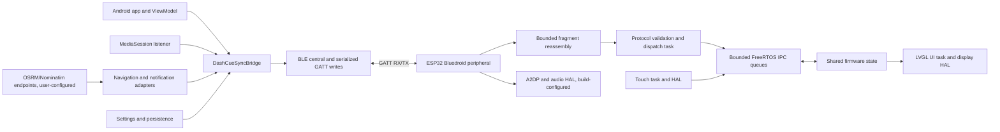

# System overview

## Scope and confidence

This describes the code in this checkout, not a release certification. The Android build is a multi-module Kotlin application targeting API 36 (minimum API 26). Firmware is C++17 on Arduino-ESP32/PlatformIO for an ESP32 CYD variant. The endpoints share protobuf payloads, a little-endian CRC32 envelope and BLE GATT fragmentation. See [protocol specification](../protocol/protocol-specification.md).

## Current architecture

The Android bridge owns synchronization of media, navigation, and settings over the BLE manager. The notification listener reads active media sessions and only recognized navigation notifications; routing and geocoding are separate configurable clients. Firmware BLE callbacks enqueue bounded packets, protocol task reassembles/decodes and dispatches to bounded queues/state, and the LVGL UI reads state. Hardware drivers include display, touch and optional audio paths.

## Readiness and feature claims

A successful Android GATT connection is not equivalent to protocol readiness: Android waits for MTU handling, service discovery, CCCD write, HELLO_ACK, snapshot synchronization, and only then marks READY. Firmware code includes protocol routing for media/navigation/settings and artwork storage. The Android artwork send path is deliberately disabled in `DashCueSyncBridge`; artwork transfer is therefore **not end-to-end enabled** in this build. Navigation has both notification mirroring and an OSRM/location engine, but a configured external endpoint and physical workflow are needed for product-level verification.

| Capability | Status in this audit |
|---|---|
| Android app and firmware build paths | Implemented; automated build results in [E2E results](../testing/e2e-results.md) |
| BLE framing, CRC, fragmentation | Implemented; host/unit tests available; cross-device re-test blocked |
| Authenticated BLE pairing | Security settings corrected in source; physical pair/access retest not run |
| Media session ingestion and control | Implemented in source; real-player-to-HUD workflow not verified in this audit |
| Settings synchronization | Implemented in source; physical round trip not verified |
| Navigation notifications / routing | Partial; endpoint/GPS workflow not run |
| Artwork over BLE | Firmware consumer exists; Android transmitter disabled; not enabled end to end |
| A2DP/I2S audio on the captured physical unit | Build path exists; serial capture reports I2S registration failure; fail/blocked for validation |
| Safety certification / vehicle use | Not applicable / not established; this is not a certified automotive system |

See [component map](component-map.md), [data flow](data-flow.md), [trust boundaries](trust-boundaries.md), and the [audit findings](../audit/findings.md).